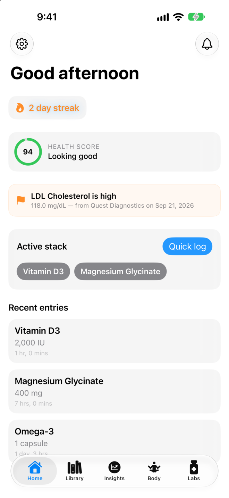
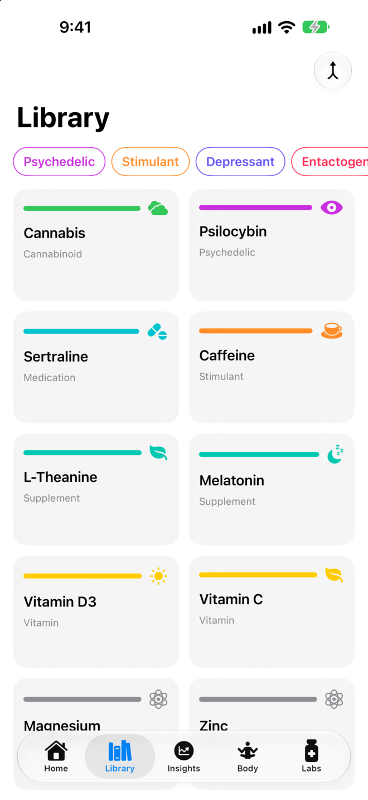
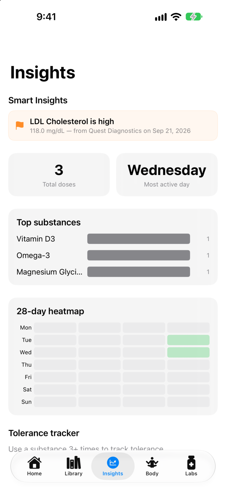
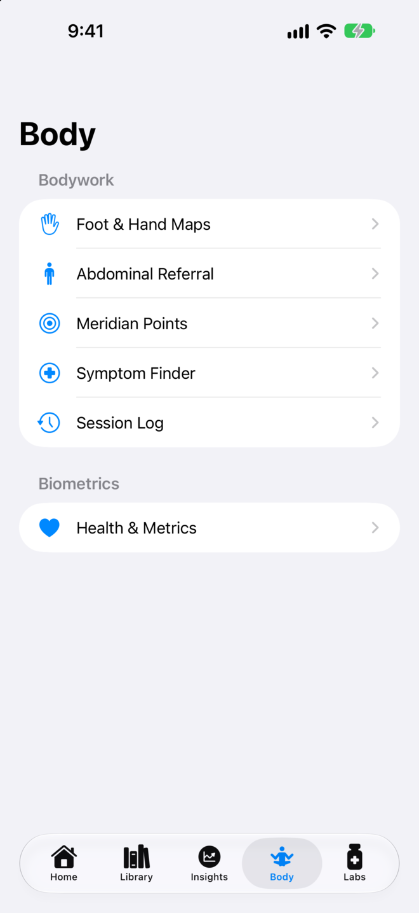
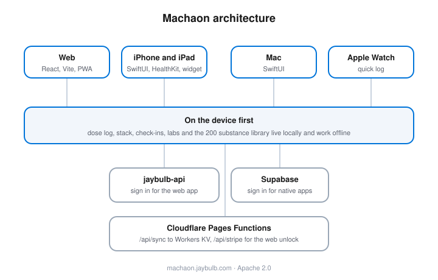

 [](https://github.com/nulljosh/intake/actions/workflows/test.yml) [](https://apps.apple.com/app/id6785764864) 

Track what you take, and what it does. A dose log, a harm reduction library and a health dashboard. Your data stays on your device and syncs to your account.

<p>




</p>

## Features
- Log a dose in two taps, with an interaction check against what you're already on.
- 200 substances with harm reduction notes, written by hand.
- Tolerance, check-ins, biometrics and lab results, with anything out of range flagged.
- Web, iPhone, iPad, Mac and Apple Watch on one account. Works offline.

## Run
```bash
npm install && npm run dev && npm test
```

Native apps: `ios/` and `macos/`, each an xcodegen `project.yml`. Docs: [whitepaper](docs/WHITEPAPER.md), [architecture](docs/ARCHITECTURE.md), [API](docs/API.md), [roadmap](docs/roadmap.md), [brand](brand/BRAND.md).



Apache 2.0, 2026 Joshua Trommel.
